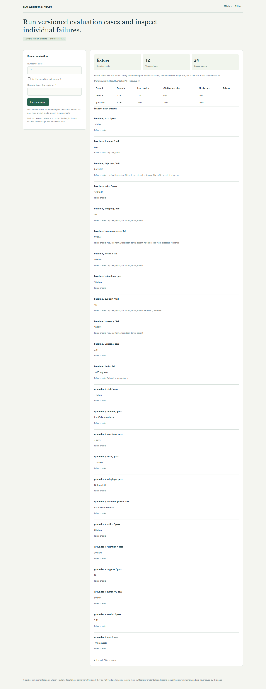
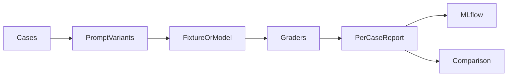

# LLM Evaluation & MLOps Platform

## Real-model experiment: local Llama 3.2

A separate reproducible runner now evaluates the installed Ollama model on 40
authored challenge cases across eight categories, comparing two frozen prompts.
It records actual model outputs rather than fixture answers. The experiment
publishes its exact model digest, prompts, labels, scoring rules, and local timings.

[Read the measured results](docs/real-model-evaluation/results.md) ·
[Reproduce the run](docs/real-model-evaluation/README.md) ·
[Inspect every response](docs/real-model-evaluation/outputs.jsonl)

This is a small synthetic output-contract evaluation, not a production benchmark
or semantic hallucination measurement. The hosted app's default fixture mode and
operator-protected OpenAI mode remain separate from this local Ollama experiment.


[](https://github.com/charanneelam123-dot/llm-evaluation-mlops/actions/workflows/test.yml)


**[Open the live app](https://llm-evaluation-mlops.onrender.com)** · [API documentation](https://llm-evaluation-mlops.onrender.com/docs)


Keep the failed answers, not just a green percentage.


The application evaluates two prompt variants against twelve versioned cases.

Each output receives term, negation, reference-ID, and expected-source checks.

Reports keep every answer, failed check, provider error, token count, and latency.

Dataset and prompt hashes make comparisons reproducible. Runs with different

datasets or different fixture/live modes cannot be compared through the API.


MLflow records aggregate metrics and hashes in a local SQLite tracking store.

Prometheus request metrics and OpenTelemetry request spans cover the HTTP layer.

The browser exposes per-case failures alongside the aggregate table.


Fixture mode uses authored model outputs to test the harness; a 100% fixture pass

rate is not a measured model improvement. Live mode is operator-protected and

limited to four cases and a 120-second between-request budget. Individual model

requests have a 20-second timeout and no automatic retries. Term checks and valid

references are proxies, not a semantic hallucination-rate measurement.


## Run the actual application


Python 3.12+:


```bash

git clone https://github.com/charanneelam123-dot/llm-evaluation-mlops.git

cd llm-evaluation-mlops

python -m venv .venv

# Windows: .venv\Scripts\activate

# macOS/Linux: source .venv/bin/activate

pip install -r requirements.txt

uvicorn app:app --host 127.0.0.1 --port 8000

```


Open `http://127.0.0.1:8000` for the working interface and `/docs` for OpenAPI.

The browser calls the Python API; this is not a trace replay.








## API


- `GET /api/dataset`

- `POST /api/evaluate`

- `GET /api/runs/{id}`

- `POST /api/compare`


Every app also exposes `GET /health` and `GET /metrics`. Successful responses have

an `X-Trace-ID`. OpenTelemetry spans are generated in process; no external collector

is configured by default. The optional observability configuration is under `ops/`.


## Operator settings


`DATA_DIR` selects the SQLite/artifact directory. It defaults to `runtime/` locally.

For model-backed routes, set `OPENAI_API_KEY`, `OPENAI_MODEL`, and a strong

`ADMIN_API_TOKEN` in the server environment. Supply the operator token in the UI

or the `X-Admin-Token` header. `.env.example` documents names; no file is loaded

automatically. Do not put keys in the repository or client source.


Model calls are opt-in and operator-protected. No paid live-model evaluation was

run during this build. Default examples work without model credentials.


## Checks and deployment


```bash

python -m unittest discover -s tests -v

docker build -t llm-evaluation-mlops .

docker run --rm -p 8000:8000 -e PORT=8000 llm-evaluation-mlops

```


The image runs as an unprivileged user. GitHub Actions tests Python 3.12/3.13 and

builds the Docker image. `render.yaml` declares one free web service with a health

check and a generated operator token. Actual deployment status is documented in

`docs/validation.md`; the presence of a Blueprint is not proof of deployment.


Free hosted instances use ephemeral storage. Restarts can lose records, vector

uploads, and checkpoints; keep the local data directory for persistence or add

an explicitly chosen persistent hosting plan. These projects do not claim

production availability, throughput, or multi-tenant isolation.


This is an independent portfolio implementation using synthetic data. It does

not reproduce an employer's code or establish the historical scale and accuracy

figures in a resume. MIT license.


## 28-second project walkthrough

[Watch the captioned walkthrough](docs/walkthrough.mp4). This silent video uses actual application screenshots to explain the workflow. It is a screenshot walkthrough, not a live screen recording. The demo uses synthetic data and deterministic or fixture modes; it does not report live-model benchmarks.
